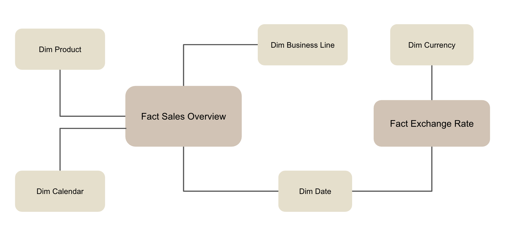
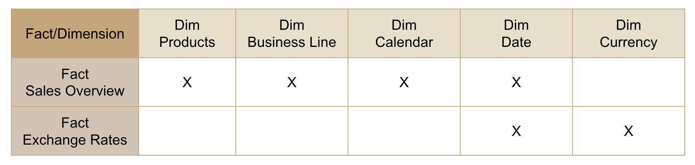
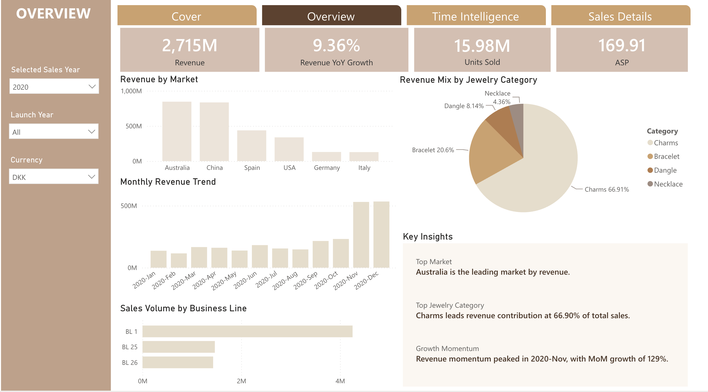
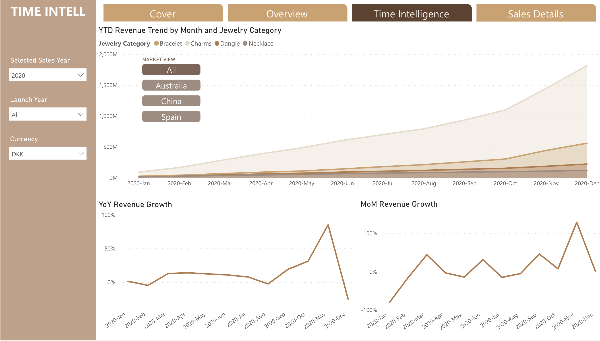
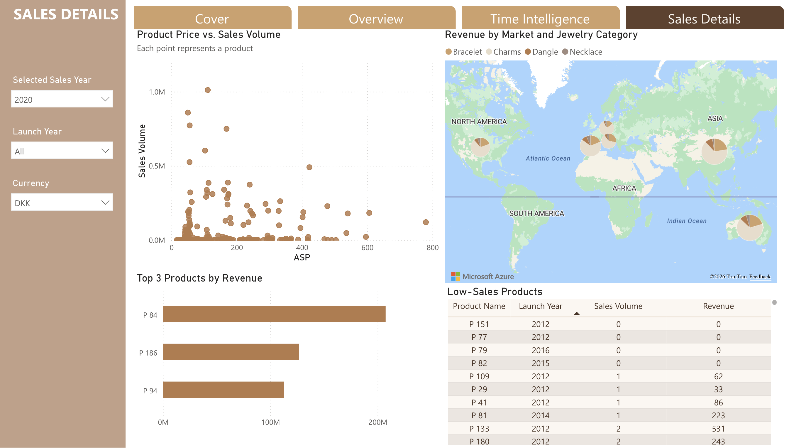

# Aurelia Sales Data Analysis

## 📊 Project Overview

This project analyzes jewelry sales performance across markets, top-selling products, and sales development.

The analysis focuses on revenue performance, sales volume, pricing, market contribution, product performance, and growth trends, with the goal of identifying key business patterns and areas for further investigation.

The analysis was developed in Power BI, combining data modeling, DAX measures, time intelligence, interactive visualizations, and business-focused insights.

---

## 🎯 Business Context & Objectives

Sales management needs a clear view of business performance across markets, products, and time to understand where revenue is generated, how sales are evolving, and which areas may require further investigation.

The dashboard was designed to provide a consolidated view of:

- Revenue and sales volume
- Revenue growth over time
- Market and product contribution
- Average Selling Price (ASP)
- Product-level performance
- Sales performance across different currencies

The objective is to move from high-level performance monitoring to more detailed analysis of markets, products, pricing, and sales trends.

---

## 🔍 Business Questions

The analysis focused on five core business questions:

1. Which markets and product categories are driving revenue?
2. How is sales performance evolving over time?
3. Is revenue growth driven by sales volume, pricing, or both?
4. Which products are the strongest and weakest performers?
5. How do sales volume and ASP differ across markets?

---

## 🗂️ Data & Modeling

### Data Grain

The core sales data is structured at the grain of **Year Week × Business Line × Product**, with Sales Quantity and Sales Amount (DKK) as the primary measures.

### Star Schema

The analytical model uses a star-schema-oriented structure, with `FactSalesOverview` at the center and dimensions for Product, Business Line, Date, and Currency.

This structure separates measurable business activity from descriptive attributes and supports flexible analysis across markets, products, categories, and time.



### Bus Matrix

The bus matrix was used to define how shared dimensions support the different business processes in the analytical model.



This provides a high-level view of the analytical architecture and helps maintain consistent dimensions across business processes.

---

## 🛠️ Analytical Approach

The analysis followed a structured workflow from data preparation and modeling to metric development and business analysis.

- **Data Preparation:** Cleaned and structured the source data using Power Query and established the required relationships.
- **DAX & Time Intelligence:** Developed measures for Revenue, Sales Volume, ASP, YTD, MoM Growth, YoY Growth, and dynamic currency conversion.
- **Business Logic:** Applied business rules to ensure that product performance was evaluated within the appropriate sales period, including excluding products that had not yet launched.

---

## 📈 Dashboard

The final Power BI report consists of three analytical pages.

### 1. Overview

Provides a high-level view of overall sales performance, including:

- Revenue and YoY Growth
- Sales Volume
- Average Selling Price
- Revenue by Market
- Monthly Revenue Trend
- Revenue Mix by Jewelry Category
- Sales Volume by Business Line



---

### 2. Time Intelligence

Focuses on understanding sales performance and growth over time.

Key analyses include:

- YTD Revenue Trend
- MoM Revenue Growth
- YoY Revenue Growth
- Revenue trends by Jewelry Category
- Interactive market views



---

### 3. Sales Details

Provides a deeper view of product and market performance.

Key analyses include:

- Product Price vs. Sales Volume
- Revenue by Market and Jewelry Category
- Top 3 Products by Revenue
- Low-Sales Products

The Low-Sales Products analysis applies a business rule to exclude products that had not yet launched during the selected sales period, avoiding misleading classification of products with zero sales.



---

## 💡 Key Business Insights

### Market Concentration

Australia and China are the two largest revenue-generating markets, together accounting for approximately **63% of total revenue**.

### Product Concentration

Charms contribute approximately **75% of total revenue**, making them the dominant category in the product portfolio.

### Different Market Profiles

Australia and China combine high sales volumes with relatively moderate ASPs, while Germany and Italy show lower sales volumes but substantially higher ASPs.

### Revenue Growth Drivers

Revenue performance is not driven by volume alone. In 2019, sales volume increased while ASP declined, resulting in broadly flat revenue. In 2020, both volume and ASP increased, supporting stronger revenue growth.

### Pricing Differences

Higher ASPs in Germany and Italy cannot be explained solely by product mix. ASP differences also exist within individual products across markets, suggesting that market-level pricing patterns warrant further investigation.

---

## 🔗 Interactive Power BI Report

[View the Interactive Power BI Report](https://app.powerbi.com/view?r=eyJrIjoiNDVkZTMwY2MtNzdkYS00NTYzLWE4Y2YtMTk0MGIzYTFmMmQ3IiwidCI6ImRjYzc1OGY4LTk4ZDktNGIxOC05NTNhLTJhNGRiOWE2NzdhOCJ9&pageName=4574dc6d77b747b3505d)

---

## 📁 Repository Structure

```text
Aurelia-Sales-Data-Analysis/
│
├── README.md
│
├── PowerBI/
│   └── Aurelia-Sales-Data-Analysis.pbix
│
└── Screenshots/
    ├── overview.png
    ├── time-intelligence.png
    ├── sales-details.png
    ├── data-model.png
    └── bus-matrix.png
