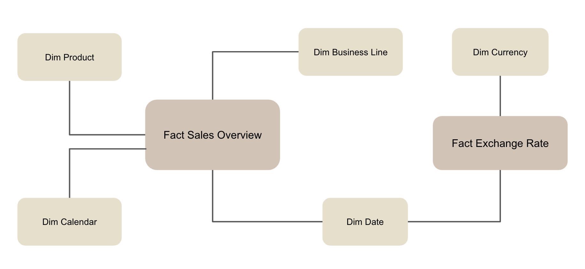
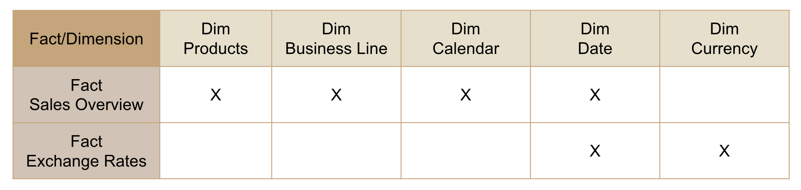
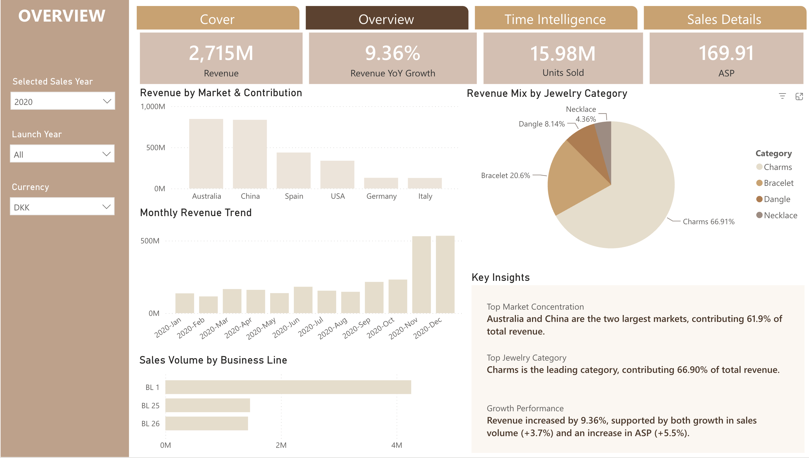
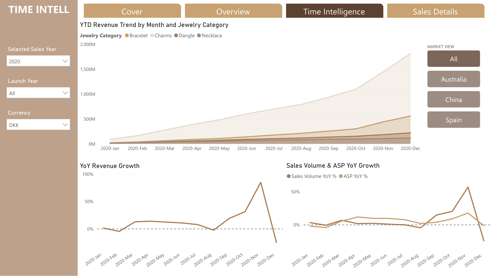
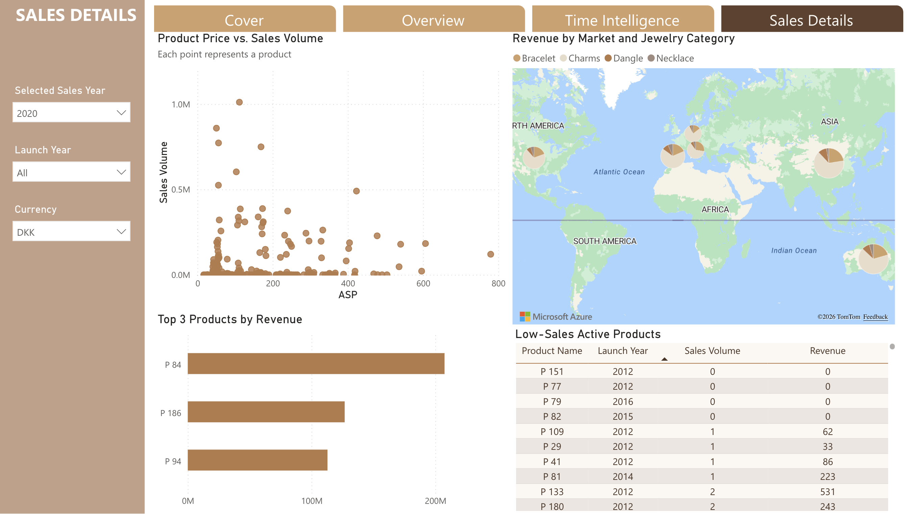

# Aurelia Sales Data Analysis

**Business Analytics Case Study powered by Power BI**

## 📊 Project Overview

This project analyzes jewelry sales performance across international markets, products, and time.

The analysis focuses on revenue performance, sales volume, pricing, market and product contribution, and growth drivers, with the goal of identifying key business patterns and areas for further investigation.

I approached this project as a **BI Analyst supporting Sales Management**, translating business requirements into an analytical model, performance metrics, and an interactive Power BI reporting solution.

---

## 🎯 Business Context

Sales management needs a clear view of business performance across markets, products, pricing, and time to understand:

- Where revenue is generated
- How sales performance is evolving
- What is driving changes in revenue
- Which markets and products require further analysis

The analysis was designed to move from high-level performance monitoring to more detailed analysis of market, product, pricing, and growth patterns.

---

## 🔍 Business Questions

The analysis focused on five core business questions:

1. **Revenue Drivers:** Which markets and product categories are driving revenue, and how concentrated is the business?
2. **Sales Performance:** How is sales performance evolving over time across revenue, volume, and ASP?
3. **Growth Drivers:** What is driving changes in revenue — sales volume, ASP, or both?
4. **Market & Product Performance:** Which markets and products show particularly strong or weak performance and therefore warrant further investigation?
5. **Commercial Performance Patterns:** How do sales volume and ASP vary across markets and product segments, and what performance patterns should management investigate further?

---

## 🗂️ Data & Analytical Model

### Data Grain

The core sales data is structured at the grain of **Year Week × Business Line × Product**, with Sales Quantity and Sales Amount (DKK) as the primary measures.

### Star Schema

The analytical model follows a star-schema-oriented structure, with `FactSalesOverview` at the center and dimensions for Product, Business Line, Date, and Currency.

This structure separates measurable business activity from descriptive attributes and supports flexible analysis across markets, products, time, and currencies.



### Bus Matrix

The bus matrix was used to define how conformed dimensions support the different business processes in the analytical model.



This provides a high-level view of the analytical architecture and helps maintain consistent dimensions across business processes.

---

## 🛠️ Analytical Approach

The analysis followed a structured workflow from data preparation and modeling to metric development and business analysis.

- **Data Preparation:** Cleaned and structured the source data using Power Query and established the required relationships.
- **DAX & Time Intelligence:** Developed measures for Revenue, Sales Volume, ASP, YTD, MoM, YoY, and dynamic currency conversion.
- **Business Logic:** Applied business rules to ensure product performance was evaluated within the appropriate sales period, including excluding products that had not yet launched.
- **Business Analysis:** Used market, product, pricing, and time dimensions to identify revenue concentration, growth drivers, and performance patterns requiring further investigation.

---

## 📈 Dashboard

The final Power BI report consists of three analytical pages.

### 1. Overview

Provides an executive-level view of overall sales performance, including:

- Revenue and YoY Growth
- Sales Volume
- Average Selling Price
- Revenue by Market and Revenue Contribution
- Monthly Revenue Trend
- Revenue Mix by Jewelry Category
- Sales Volume by Business Line
- Dynamic business insights on market concentration, category concentration, and growth performance



---

### 2. Time Intelligence

Focuses on understanding how sales performance changes over time and what drives those changes.

Key analyses include:

- YTD Revenue Trend
- YoY Revenue Growth
- Volume & ASP YoY Growth
- Revenue trends by Jewelry Category
- Interactive market views



---

### 3. Sales Details

Provides a deeper view of market and product performance to identify strong performers and areas for further investigation.

Key analyses include:

- Product Price vs. Sales Volume
- Revenue by Market and Jewelry Category
- Top 3 Products by Revenue
- Low-Sales Active Products

The **Low-Sales Active Products** analysis applies a business rule to exclude products that had not yet launched during the selected sales period, avoiding misleading classification of products with zero sales.



---

## 💡 Key Business Insights

### Market Concentration

Australia and China are the two largest revenue-generating markets, together accounting for approximately **63% of total revenue**.

### Product Concentration

One jewelry category contributes the majority of total revenue, making product mix an important commercial consideration.

### Different Market Profiles

Australia and China combine high sales volumes with relatively moderate ASPs, while Germany and Italy show lower sales volumes but substantially higher ASPs.

### Revenue Growth Drivers

Revenue performance is not driven by volume alone. In 2019, sales volume increased while ASP declined, resulting in broadly flat revenue. In 2020, both volume and ASP increased, supporting stronger revenue growth.

### Pricing Differences

Higher ASPs in Germany and Italy are not driven by product mix alone. The same products show different ASPs across markets, indicating that pricing varies by market.

---

## 🔗 Interactive Power BI Report

[Click here to interact with the Power BI Report](https://app.powerbi.com/view?r=eyJrIjoiNDVkZTMwY2MtNzdkYS00NTYzLWE4Y2YtMTk0MGIzYTFmMmQ3IiwidCI6ImRjYzc1OGY4LTk4ZDktNGIxOC05NTNhLTJhNGRiOWE2NzdhOCJ9&pageName=4574dc6d77b747b3505d)

---

## 🔎 Limitations & Next Analysis

The analysis focuses on sales performance and does not include customer, margin, competitor, or detailed pricing data. As a result, the dashboard identifies performance patterns but does not explain the underlying reasons behind them.

Further analysis could combine sales data with additional business data to better understand market, product, and pricing performance.

---

## 🧰 Tools & Skills

- **BI & Visualization:** Power BI, DAX, Power Query
- **Data Modeling:** Star Schema, Fact & Dimension Tables, Bus Matrix
- **Analytics:** Time Intelligence, KPI Development, Revenue & Growth Analysis
- **Business Analysis:** Market & Product Performance, Pricing Analysis, Revenue Drivers
- **Data Preparation:** Power Query, Data Transformation

---

## 📁 Repository Structure

```text
Aurelia-Sales-Data-Analysis/
│
├── README.md
│
├── PowerBI/
│   └── Aurelia-Sales-Data-Analysis.pbix
│
└── Screenshots/
    ├── overview.png
    ├── time-intelligence.png
    ├── sales-details.png
    └── data-model.png
```
